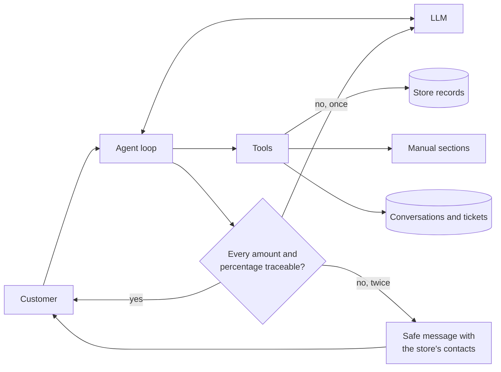

# Empório da Música — Customer Service Agent

A text-message agent for a fictional musical instrument store in Campo Grande/MS, built for the Artefact AI Engineer challenge. The customer talks to **Lia**, who answers in Brazilian Portuguese from the store's records and policy manual, and hands over to the team what needs a person.

**The core idea:** the model decides what to consult and how to say it. Deterministic Python decides what is true. A prompt can be argued with, so prices, return windows and access to customer data don't depend on it.

- [Run it](#run-it)
- [How it works](#how-it-works)
- [Technical decisions](#technical-decisions)
- [Assumptions](#assumptions)
- [Evaluation](#evaluation)
- [Known limitations and what I'd do with more time](#known-limitations-and-what-id-do-with-more-time)
- [Use of AI coding assistants](#use-of-ai-coding-assistants)
- [Example conversations](examples/)

## Run it

Requires Python 3.11 or newer.

```bash
python -m venv .venv
source .venv/bin/activate      # Windows: .venv\Scripts\activate
pip install -r requirements.txt
cp .env.example .env           # Windows: copy .env.example .env
```

Edit `.env` and set a Gemini key, which [Google AI Studio](https://aistudio.google.com/apikey) provides, including on a free tier. That's the only required setting:

```bash
LLM_API_KEY=your-key
```

`.env.example` shows how to use Claude, any other OpenAI-compatible endpoint, or a local model instead.

Then talk to the agent:

```bash
python -m emporio_agent                     # terminal chat
python -m emporio_agent --debug             # also shows consultations and safety-net results
python -m emporio_agent --session <id>      # resume a conversation
python -m emporio_agent serve               # API and chat page at http://127.0.0.1:8000
```

Some data to try. Order 7 belongs to `leticia.rocha@jmail.com`, and order 8 to `anacarol.ferreira@coldmail.com`. Dates in the dataset end in March 2026, so with today's clock every return window has expired, as it should. To see them open, set `AGENT_NOW=2026-02-20T10:00:00` in `.env`.

Other commands:

```bash
pip install -r requirements-dev.txt
pytest                                      # offline, no key needed
python -m evals.run                         # scenarios against the live model
python scripts/generate_examples.py         # regenerates examples/
python scripts/profile_data.py              # regenerates docs/data_quality.md
python scripts/build_policy_kb.py           # regenerates the manual's Markdown
```

## How it works



| Question | Tool | Who decides the answer |
|---|---|---|
| "Violões até R$ 1000?" | `search_products` | Python filters by category, price and availability |
| "Quanto custa o GD20?" | `get_product` | Python calculates promotion, PIX and installments |
| "Quais promoções?" | `list_active_promotions` | Python keeps only active promotions on sellable products |
| "Qual o endereço?" | `get_policy` | The model picks a section and answers from its text |
| "Cadê meu pedido?" | `get_my_orders` | Python checks identity before reading the order |
| "Posso devolver?" | `check_return_eligibility` | Python applies the rule to the order's dates and status |
| Complaint or handover | `register_ticket` | Python records it and returns a protocol |

## Technical decisions

The work followed a spec-driven process. The spec, plan, tasks and decision records are in [`specs/`](specs/), and each requirement traces to tasks and acceptance criteria.

### Agent approach: function calling, without a framework

A loop of about 60 lines in [`agent.py`](emporio_agent/agent.py) with seven typed tools. The brief asks for the simplest solution, and this flow is one cycle: LangGraph would add a dependency tree and indirection without adding capability. I'd revisit that if the flow gained real branching or several agents. ([ADR-001](specs/adr/ADR-001-tool-calling-without-framework.md))

I also rejected **text-to-SQL**. It's flexible, but the questions here are a closed family, and it would let generated queries decide who can read the customer table.

### Retrieval: section routing, no embeddings

The manual has 8 pages and 28 numbered sections. Its table of contents goes in the `get_policy` tool description, and the model asks for sections by number, receiving each one whole. ([ADR-002](specs/adr/ADR-002-section-routing-retrieval.md))

- **Why not vector search?** It adds a model, an index and chunking parameters to solve a problem this corpus doesn't have. Customers say "me arrependi" and the manual says "direito de arrependimento", which a model reading a table of contents handles naturally. Rules also never get split across chunks.
- **Why not paste the whole manual into the prompt?** It was a close second. But every greeting would pay for the whole manual, and the trace of which rule was used would be lost.
- **When would this be wrong?** With many documents. Then vector or hybrid search becomes worthwhile.

Catalog and order questions don't go through retrieval at all, since similarity search can't reliably answer "under R$ 1000".

### Model and provider: Gemini by default, replaceable by configuration

The default is `gemini-3.8-flash`, at USD 0.75 / 3.75 per million input / output tokens until 2026-12-31 and USD 1.50 / 7.50 after that. Short service replies don't need a flagship model, it supports function calling, and Google's free tier means an evaluator can run the same setup at no cost. I started with the cheaper option and let the evaluation suite decide whether it was enough. ([ADR-005](specs/adr/ADR-005-gemini-as-primary-model.md))

A small adapter in [`llm.py`](emporio_agent/llm.py) isolates the provider, so business code imports no SDK and changing model is one environment variable. It speaks to any OpenAI-compatible endpoint, and also to Claude through Anthropic's own SDK. The Claude path is covered by unit tests with a fake client, but I haven't run it against the live API, so results here apply only to the model in the evaluation report. On every provider, a refusal ends in the safe message rather than an empty reply.

### Rules in code, and a safety net

Three guarantees hold whatever the model does. ([ADR-004](specs/adr/ADR-004-rules-in-code.md))

1. **Identity.** `get_my_orders` requires the order number plus the email or phone on file, or both without a number. The check happens before the order is read, so a prompt injection has nothing to extract. Failures look the same whether or not the order exists, and three failures lock the conversation.
2. **Calculated values.** Promotion, PIX and installments arrive ready to use, so the model does no arithmetic. Return windows are calculated from the order's dates.
3. **Traceability.** Before a reply is sent, [`guard.py`](emporio_agent/guard.py) checks that each `R$` amount and percentage appeared in a tool result, the manual, or the customer's own message. A failed draft is regenerated once, and if it fails again the customer gets the store's contacts instead. The manual itself warns that a wrong price may amount to misleading advertising.

### Prompt strategy

- **Versioned file in Portuguese:** [`system_prompt.md`](emporio_agent/prompts/system_prompt.md). It's in the customer's language so that it sets the tone by example, and it explains why rules exist instead of just listing them.
- **No facts in the prompt:** hours, prices and rules aren't there, which forces consultation and leaves one source of truth.
- **Trusted and untrusted text are separated:** customer text is wrapped in tags that the customer can't forge, because the reserved tags are stripped from input. The current time travels in each turn, not in the system prompt, keeping the cached prefix stable.
- **Tool output guides behavior:** a tool returns `verificacao_falhou` with what to do next, or withholds a product's description when the record is unreliable. This is more dependable than asking the model to remember a rule.

### Data handling

I profiled the data before designing anything, and it contains deliberate traps. The full list, with the agent's behavior for each one, is in [`docs/data_quality.md`](docs/data_quality.md). The source records are never changed. The main ones:

| Finding | Behavior |
|---|---|
| Discontinued product with 13 units, unreleased product with 2 | Status beats stock: neither is offered for purchase |
| 21 inactive promotions, some products having several | Only `is_active` counts, and an expired discount is refused with transparency |
| 7 products whose description names another brand | The description is withheld, and the team confirms details |
| 3 categories with no products, against a manual claiming 300+ instruments | The records decide; no product is invented |
| 2 orders whose total differs from their items | The recorded total is reported, and questions go to the team |
| 2 customers sharing an email | Listing orders requires both email and phone |
| Manual with two phones, two emails and two installment rules | Resolved once, documented, and visible as notes in the Markdown |

The manual is extracted with `pdfplumber` into [reviewable Markdown](emporio_agent/knowledge/policies.md), because plain extractors broke its tables. Resolution notes are clearly labelled as not being part of the original manual.

### Interface: CLI, plus a thin API

The challenge's focus is the agent, so the CLI comes first. A small FastAPI layer and a one-page chat exist because the real channel is WhatsApp: the store's next step would be a webhook calling `POST /api/v1/chat`.

### Public demo on Vercel

The same app can run on Vercel, so that someone can try it without installing anything. ([ADR-006](specs/adr/ADR-006-public-demo-on-vercel.md)) To deploy your own, import the repository as a Vercel project and set `LLM_API_KEY` in its environment variables. Two trade-offs come with it:

- **State is temporary.** Functions can only write to a temporary directory, so conversations, tickets and the verification lockout can reset when an instance changes. A managed database would be the first change for real traffic. The local version doesn't have this limitation.
- **A public URL can spend the key.** The API limits messages per client and per day before calling the model, and interactive API docs are off. These counters are per instance, so the provider's spending cap is the real ceiling.

### Conversation persistence: yes, in SQLite

A follow-up like "e esse parcela?" needs history, and customers return to a conversation later. SQLite is in the standard library and needs no server. Each turn also records consultations, latency, tokens and safety-net results, with verification data redacted from the audit trail.

## Assumptions

The brief asks for documented assumptions when information is missing. Each one could be overruled by the store.

| # | Assumption | Why |
|---|---|---|
| A1 | The estimated delivery date stands in for the receipt date, and replies say so | Records have no actual delivery date, and return windows depend on it |
| A2 | Every recorded order is treated as online, and the team confirms | The right of regret applies to online purchases, and records have no channel |
| A3 | The 7 days for preference exchanges count from receipt | The manual gives no start date; this matches the right of regret |
| A4 | Installment rules in section 3.1 beat the general table in section 3 | The more specific rule wins |
| A5 | "(except below R$ 50,00)" means a R$ 50,00 minimum for up to 3x | The clearest reading of an ambiguous sentence |
| A6 | The official phone is (67) 3341-4444, and the email has no accent in the domain | The phone appears twice, labelled as phone and messaging; an accented domain looks like a typo |
| A7 | Records beat the manual on what can be sold | The manual claims 300+ instruments; records have 65 |
| A8 | No partner store is ever named | The manual says to suggest them, but lists none |
| A9 | The clock is real unless `AGENT_NOW` is set | Data ends in March 2026, so examples and evaluation fix a date inside the period |
| A10 | The recruiter's "all responses must be in English" covers documents and code; the agent speaks Portuguese to customers | The store's customers are Brazilian |
| A11 | Holidays are national fixed dates only | Municipal and movable holidays aren't available to the system |
| A12 | The public demo may lose a conversation's memory or a ticket | Serverless functions have temporary storage, which is acceptable for a short evaluation |

## Evaluation

**Offline:** the test suite cover pricing boundaries, identity rules, return windows, the safety net, the agent loop, API and adapters. They need no key or network.

**Live:** [`evals/cases.py`](evals/cases.py) has 44 scenarios with deterministic assertions on tools used and reply content. Data leakage and manipulation have zero tolerance.

<!-- LIVE-RESULTS -->
Live results are pending a run with an LLM credential.
<!-- /LIVE-RESULTS -->

## Known limitations and what I'd do with more time

**Known limitations**

- **Identity is knowledge-based.** Anyone who knows an order number and its email can see that order. A real deployment would use the verified number from the messaging channel.
- **Lockout is per conversation.** A new conversation resets the counter. Production needs limits by order and origin. The API also has no authentication, so locally it binds to localhost, and the public demo holds only fictional data.
- **The public demo keeps temporary state.** See [Public demo on Vercel](#public-demo-on-vercel).
- **The safety net only sees numbers.** A wrong non-numeric claim, like a false product feature, passes through. The prompt and the evaluation cover those, but without a guarantee. It can also block a legitimate calculated amount, in which case the customer gets the safe message.
- **Tickets are only recorded.** Nobody is notified. Conversations stored locally include personal data typed by customers, with no retention policy.
- **Stock is a snapshot.** Records load at startup.
- **Holidays and freight** are partial: national fixed-date holidays only, and no freight quotes outside the manual's fixed rules.
- **Evaluation assertions are regular expressions.** They catch facts well but can't judge tone.
- **Evaluation results are valid only for the model recorded in the report.** Free-tier models may behave differently.

**With more time**

1. A WhatsApp webhook with identity from the channel, which would also remove most of the verification friction.
2. Automatic notification of tickets to the team, plus a small inbox, since the team is who this helps.
3. Model benchmarking with the existing suite, and cost per conversation in the audit trail.
4. Evaluation with a judge model for tone and with real conversations, feeding the suite from production failures.
5. Live connections to stock and order systems, and an LGPD retention policy with a deletion flow.
6. A semantic review of replies for high-risk topics, if measurement shows the numeric check isn't enough.

## Use of AI coding assistants

I used **Claude Code** (desktop app, Claude Opus 5.5) as the main tool in this project, and it wrote most of the code and documents under my direction. This is how the workflow went:

1. **Process first.** I gave it the challenge, the recruiter's email, and a spec-driven development kit from another project. It adapted the kit to this project and produced the spec, plan, tasks and ADRs before any code, and these became the contract for implementation.
2. **Data profiling before design.** It read the manual and the CSVs and listed the contradictions and traps that became requirements.
3. **Implementation in stages.** Stage-by-stage commits in this repository show how the project evolved, with tests alongside each stage.
4. **Verification.** The offline tests, the live evaluation suite and a browser check of the chat page were used to check its work, rather than trusting a report of success. Example conversations are generated by a script and not edited.
5. **Review.** Human-only steps are listed in [`tasks.md`](specs/2026-10-emporio-service-agent/tasks.md). Reviewing the result, running it from a fresh clone and submitting it are mine.


## Project layout

```
emporio_agent/
  agent.py          conversation loop, safety-net retry, fallbacks
  tools.py          tools, identity verification, return rules
  pricing.py        promotion, PIX and installment rules
  store_data.py     loads and normalizes the records
  policies.py       manual sections
  guard.py          traceability check
  clock.py          opening hours and next opening
  llm.py            provider adapters
  storage.py        conversations, audit trail, tickets
  cli.py, api.py    interfaces
  prompts/          system prompt
  knowledge/        the manual as Markdown
data/               the store's records and manual
docs/               data quality report
evals/              live scenarios and reports
examples/           real conversations
scripts/            manual conversion, data profiling, example generation
specs/              spec, plan, tasks and ADRs
tests/              offline tests
```
